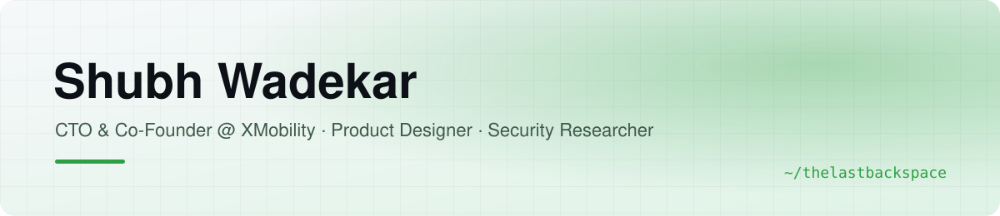

<picture>
  <source media="(prefers-color-scheme: dark)" srcset="assets/banner-green-dark.svg">
  
</picture>

Bridging high-performance engineering, AI automation and pixel-perfect UX.
I take products from a blank Figma file to production, find security holes before attackers do, and fix other people's bugs for fun. Based in Bengaluru, India.

---

## Open source

I fix real, reported bugs in projects people depend on, with a regression test for every change.

<!-- OSS:START -->
| Project | Pull request |
|---|---|
|  **[dora-rs/dora](https://github.com/dora-rs/dora/pull/4055)** | fix(node): coerce mixed-type JSON arrays in untyped integration-testing inputs |
|  **[tursodatabase/turso](https://github.com/tursodatabase/turso/pull/11412)** | core/time: return NULL instead of panicking when time_date overflows |
<!-- OSS:END -->

More on the way. <a href="https://github.com/search?q=author%3Athelastbackspace+is%3Apr+-user%3Athelastbackspace+-org%3AXmobility-ai&type=pullrequests">All my pull requests</a>

---

## Security research

Found and privately reported critical vulnerabilities in **10+ apps and websites** in two weeks, including exposed customer PII, a flaw that let anyone trigger refunds on other customers' orders, and a way to unlock electric bikes without access. Each one was disclosed responsibly and fixed with the company; several were rewarded with bug bounties and recognised by the founders and leadership.

---

## Things I built

| Product | What it does |
|---|---|
| **[XMobility](https://xmobility.ai)** | AI suite for global mobility, visa to payroll: Immigration, EOR, HRMS and Payroll on one shared record. A no-code workflow engine runs any visa or process in any country, an AI agent reads documents and fills forms, and an MCP server lets users manage cases from Claude. Live with paying customers. |
| **[Crawlfox](https://crawlfox.io)** | Web scraping product with real users. Shipped in 3 months, 90%+ success rate. |

<a href="https://github.com/thelastbackspace/cursor-auto-resume"><picture><source media="(prefers-color-scheme: dark)" srcset="https://github-readme-stats.vercel.app/api/pin/?username=thelastbackspace&repo=cursor-auto-resume&hide_border=true&bg_color=0d1117&title_color=3fb950&icon_color=3fb950&text_color=c9d1d9"></picture></a>
<a href="https://github.com/thelastbackspace/traceperf"><picture><source media="(prefers-color-scheme: dark)" srcset="https://github-readme-stats.vercel.app/api/pin/?username=thelastbackspace&repo=traceperf&hide_border=true&bg_color=0d1117&title_color=3fb950&icon_color=3fb950&text_color=c9d1d9"></picture></a>
<a href="https://github.com/d3vx-com/d3vx"><picture><source media="(prefers-color-scheme: dark)" srcset="https://github-readme-stats.vercel.app/api/pin/?username=d3vx-com&repo=d3vx&hide_border=true&bg_color=0d1117&title_color=3fb950&icon_color=3fb950&text_color=c9d1d9"></picture></a>
<a href="https://github.com/thelastbackspace/zig-npm-ports"><picture><source media="(prefers-color-scheme: dark)" srcset="https://github-readme-stats.vercel.app/api/pin/?username=thelastbackspace&repo=zig-npm-ports&hide_border=true&bg_color=0d1117&title_color=3fb950&icon_color=3fb950&text_color=c9d1d9"></picture></a>

---

## Journey

- **Co-Founder & CTO @ [XMobility](https://xmobility.ai)** · *Mar 2025 – now*
  Built the MVP alone in **30 days**, then led a team of two to production. First paying customer signed.
- **Product Manager (contract) @ Automote.io** · *Apr 2026 – now*
  Run [crawlfox.io](https://crawlfox.io) end to end. Shipped in **3 months** with a **90%+** success rate.
- **Product Manager @ RelayZen** · *Jul 2023 – Feb 2025*
  First employee. Designed the immigration case-management product from scratch and led its MVP build with three developers.
- **Product Manager @ Medicodio** · *Jul 2023 – Feb 2025*
  Rebuilt the app frontend in **45 days** with a two-person team, fixed **400+ legacy bugs**, and doubled website impressions to **140K a month**.
- **Product Designer (first employee) @ Keel** · *May 2021 – Jul 2023*
  Built the design function from scratch and designed the app and website. The company went on to raise investment.
- **Founder @ We Switched Studio** · *Feb 2020 – May 2024*
  Design and dev studio with **100+ client projects**, including Streax. Trained and hired students from rural backgrounds.
- **Growth Hacker → Software Engineer @ CloudxLab** · *Jul 2019 – Nov 2020*
  Helped grow revenue from **$3K to $100K a month** in six months, then moved into frontend engineering.
- **Co-Founder @ Gamersback** · *Apr 2018 – Apr 2019*
  Platform for gamers. Selected for pre-incubation at **NSRCEL, IIM Bangalore**.

B.Tech, Information Technology · SRM University (2015 – 2019)

---

## Toolbox

  <picture>
    <source media="(prefers-color-scheme: dark)" srcset="https://skillicons.dev/icons?i=figma,ts,react,nextjs,nodejs,rust,go,python,zig,mongodb,postgres,docker,tauri&theme=dark&perline=13">
    
  </picture>

Design systems · Product strategy · User research · AI agents and MCP · Claude Code · Cursor

---

<picture>
  <source media="(prefers-color-scheme: dark)" srcset="https://github-readme-stats.vercel.app/api?username=thelastbackspace&show_icons=true&hide_border=true&count_private=true&include_all_commits=true&bg_color=0d1117&title_color=3fb950&icon_color=3fb950&text_color=c9d1d9">
  
</picture>
<picture>
  <source media="(prefers-color-scheme: dark)" srcset="https://streak-stats.demolab.com?user=thelastbackspace&hide_border=true&background=0D1117&ring=3fb950&fire=3fb950&currStreakLabel=3fb950&sideLabels=C9D1D9&currStreakNum=C9D1D9&sideNums=C9D1D9&dates=8B949E">
  
</picture>
<picture>
  <source media="(prefers-color-scheme: dark)" srcset="https://github-readme-stats.vercel.app/api/top-langs/?username=thelastbackspace&layout=compact&hide_border=true&langs_count=8&bg_color=0d1117&title_color=3fb950&text_color=c9d1d9">
  
</picture>

<picture>
  <source media="(prefers-color-scheme: dark)" srcset="https://raw.githubusercontent.com/thelastbackspace/thelastbackspace/output/snake-dark.svg">
  
</picture>

